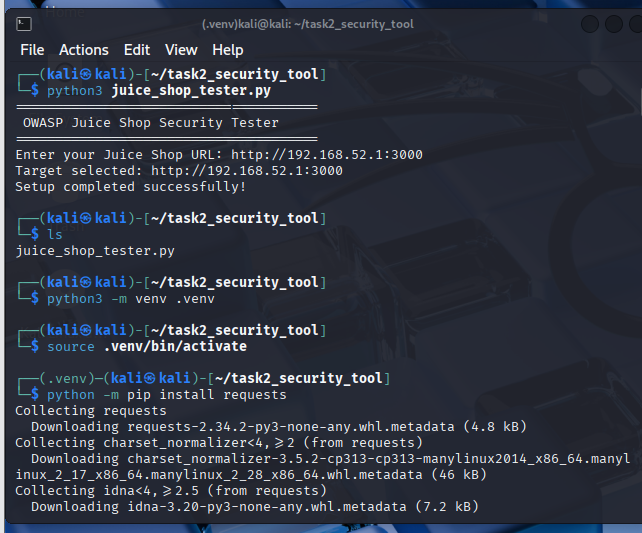
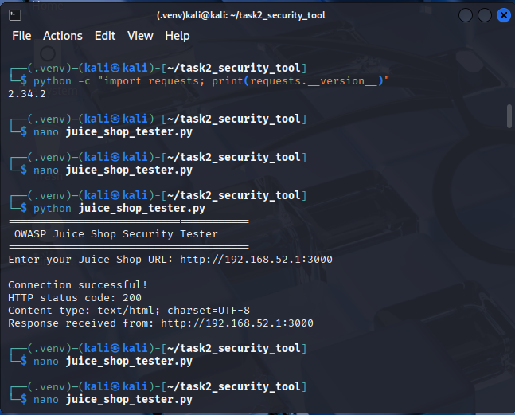
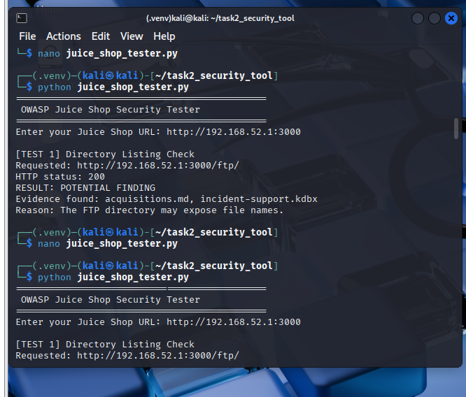
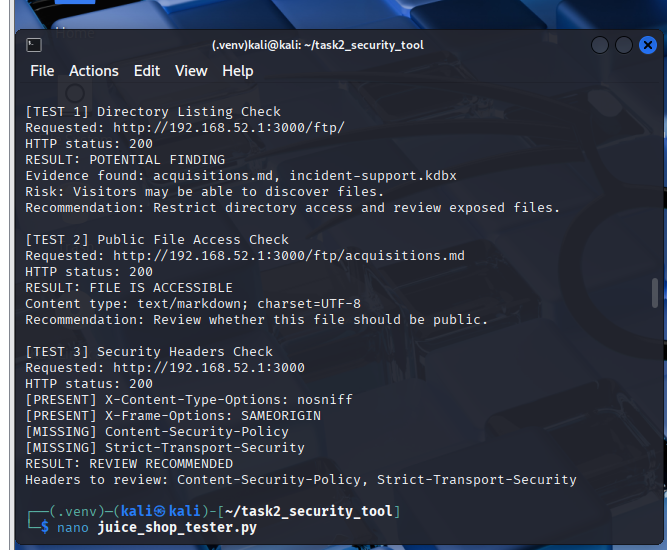
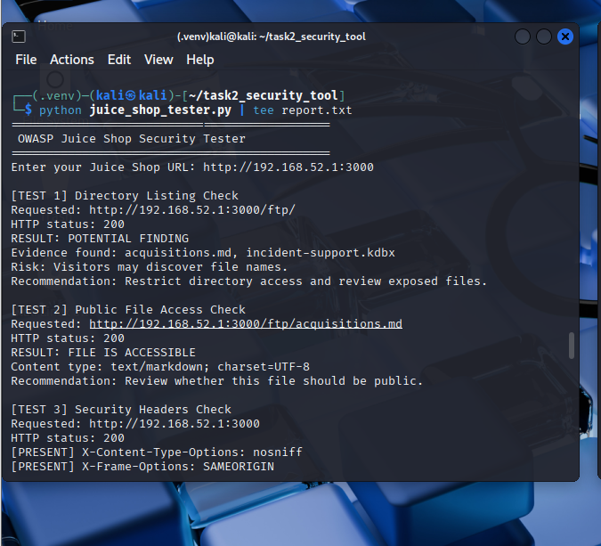
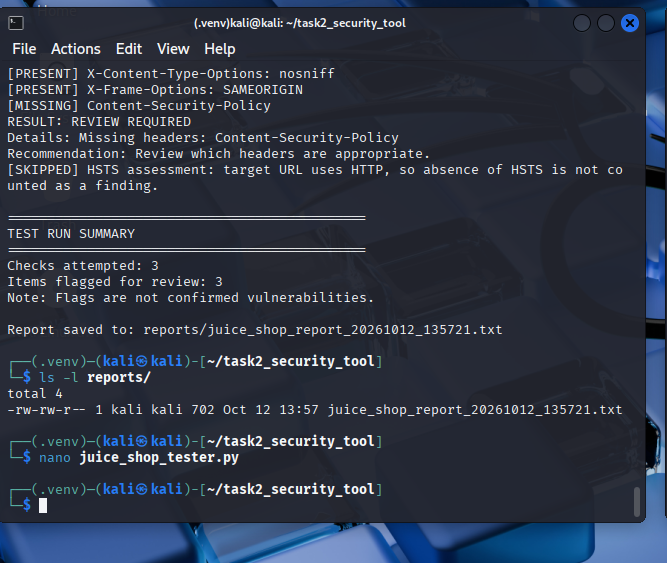

# Automated Attack-Point Testing — OWASP Juice Shop
### Security Testing Report — Task 2

**Author:** Sheeza Alam Khan
**Target:** OWASP Juice Shop (local authorized lab instance — `http://192.168.52.1:3000`)
**Date of testing:** 12 October 2026
**Tool:** `juice_shop_tester.py` (Python 3, `requests`)

---

## 1. Executive Summary

This report documents the design, build, and execution of a custom Python automation tool that tests three attack points on an OWASP Juice Shop instance that was deployed and authorized for this assessment. The tool sends non-destructive HTTP requests, inspects the responses, flags conditions that merit manual review, and writes a timestamped report file — turning a manual testing workflow into a repeatable one.

Across the three checks, all three were flagged for review:

| # | Attack point | Result | Severity (triage) |
|---|---|---|---|
| 1 | Directory listing (`/ftp/`) | **Potential finding** — indicator strings present | Medium |
| 2 | Public file access (`/ftp/acquisitions.md`) | **Review required** — file returned HTTP 200 | Medium |
| 3 | Security headers (`/`) | **Review required** — CSP and HSTS missing | Low–Medium |

None of these are treated as confirmed vulnerabilities by the tool itself — each is a triage signal that a human reviewer should verify, consistent with the task's scope (build a reliable automation workflow, not a maximal exploitation run).

---

## 2. Scope and Authorization

Testing was performed exclusively against a locally deployed OWASP Juice Shop instance (`192.168.52.1:3000`) running on an isolated Kali Linux lab environment set up for this coursework. No external or third-party systems were targeted. All requests used standard, non-destructive HTTP `GET` methods — no exploitation, data modification, or denial-of-service activity was performed.

---

## 3. Attack Points Selected

Three attack points were selected from the Week 1 attack-surface mapping of Juice Shop:

1. **Directory/file exposure under `/ftp/`** — a known Juice Shop component that serves files from a predictable path.
2. **Direct access to a specific file** (`/ftp/acquisitions.md`) — tests whether a specific resource is reachable without authentication.
3. **HTTP security headers on the application root** — tests the presence of baseline hardening headers (`X-Content-Type-Options`, `X-Frame-Options`, `Content-Security-Policy`, and `Strict-Transport-Security` on HTTPS targets).

These were chosen because they are externally reachable without credentials, require no destructive payloads, and map to common real-world findings (information disclosure and missing hardening headers) that a SOC/AppSec analyst would triage in practice.

---

## 4. Tool Architecture

The tool is a single Python script built around a simple, repeatable pattern:

- **Input handling** — prompts for a target base URL at runtime and validates it (scheme, hostname, no embedded whitespace) before sending any requests.
- **Three independent test functions** — `test_directory_listing()`, `test_public_file()`, `test_security_headers()` — each targeting one attack point, sharing the same request/response/record pattern so the tool is a cohesive suite rather than three unrelated scripts.
- **Response analysis** — each test inspects status codes and, where relevant, response body content or specific headers against defined indicators.
- **Finding detection** — results are classified into consistent labels (`POTENTIAL FINDING`, `REVIEW REQUIRED`, `NOT DETECTED` / `NOT FOUND`, `INCONCLUSIVE`, `TEST ERROR`) rather than a binary pass/fail, reflecting that automated signals need human confirmation.
- **Error handling** — every network call is wrapped in a `try/except` around `requests.exceptions.RequestException`, so a timeout or connection failure is recorded as a `TEST ERROR` rather than crashing the run.
- **Reporting** — results are printed to the terminal in real time and also written to a timestamped `.txt` report under `reports/`, giving both an interactive and an archival output.
- **Reusability** — because the target URL is supplied at runtime rather than hard-coded, the same script can be pointed at another authorized Juice Shop instance without code changes.

---

## 5. Testing Methodology and Results

### Test 1 — Directory Listing Indicators
**Request:** `GET {base_url}/ftp/`
**Method:** Sends the request with a 5-second timeout, then searches the lowercased response body for known indicator strings (`index of /ftp`, `directory listing for /ftp`, `acquisitions.md`, `incident-support.kdbx`).
**Observed result:** HTTP 200. Indicators `acquisitions.md` and `incident-support.kdbx` were found in the response.
**Interpretation:** The `/ftp/` path exposes file names that were likely not intended to be publicly discoverable. This is flagged as a **potential finding** — the next step is to confirm whether this directory is meant to be browsable and whether the listed files should be reachable without authentication.

### Test 2 — Public File Access
**Request:** `GET {base_url}/ftp/acquisitions.md`
**Method:** Sends the request and records the status code and `Content-Type` header. HTTP 200 is flagged for review; 401/403 is treated as access restricted; 404 as not found.
**Observed result:** HTTP 200, `Content-Type: text/markdown; charset=UTF-8`.
**Interpretation:** The file is directly accessible with no authentication. Accessibility alone does not prove a vulnerability, but combined with Test 1 it indicates the `/ftp/` directory is both enumerable and its contents are retrievable — worth a manual review of what the file contains and who should be able to read it.

### Test 3 — Security Headers
**Request:** `GET {base_url}/`
**Method:** Inspects `X-Content-Type-Options`, `X-Frame-Options`, and `Content-Security-Policy` on every response; separately checks `Strict-Transport-Security` only when the target uses HTTPS (an HTTP target is not penalized for missing HSTS, since HSTS is meaningless without TLS).
**Observed result:** `X-Content-Type-Options: nosniff` and `X-Frame-Options: SAMEORIGIN` were present. `Content-Security-Policy` was **missing**. The target used HTTP, so the HSTS check was skipped by design rather than flagged.
**Interpretation:** The application has partial hardening in place (clickjacking and MIME-sniffing protections are present) but lacks a Content-Security-Policy, which would reduce the impact of any script-injection issue elsewhere in the app. This is a **review-required**, not a confirmed exploit path on its own.

---

## 6. Evidence

**Environment setup and dependency installation**

**Connectivity check against the target**

**Test 1 — Directory listing check in isolation**

**Full run — all three tests executed in sequence**

**Full run piped through `tee` for a saved terminal log**

**Report file generated and verified on disk**

Raw terminal output and the generated text report are also included in `evidence/` and `reports/` for independent review.

---

## 7. Findings Summary

| Finding | Evidence | Risk rationale | Recommendation |
|---|---|---|---|
| Directory/file-name exposure under `/ftp/` | HTTP 200 with file-name indicators in response body | Allows an attacker to enumerate file names without authentication, aiding reconnaissance | Restrict or remove directory listing; move sensitive file names out of a predictable, enumerable path |
| Publicly accessible file (`acquisitions.md`) | HTTP 200, file content retrievable | Any unauthenticated user can read the file's contents | Apply access controls or confirm the file is intentionally public |
| Missing Content-Security-Policy | Header absent from `/` response | Reduces defense-in-depth against script injection (e.g. XSS) elsewhere in the app | Add a CSP appropriate to the application's resource origins |
| Missing HSTS | Not applicable on HTTP, flagged only when the deployment moves to HTTPS | N/A for this HTTP lab target | Add HSTS once TLS is enabled |

All items are **triage-level findings** produced by an automated tool; they require manual confirmation before being treated as verified vulnerabilities, per the tool's own reporting convention.

---

## 8. Limitations

- Only three fixed checks are performed — this is a targeted tool, not a general-purpose scanner.
- Directory-listing detection relies on fixed indicator strings, which can miss other formats or produce false positives on a differently configured server.
- An HTTP 200 response does not, by itself, prove a resource was intended to be private.
- Only three security headers are checked; real-world header requirements vary by deployment context.
- The tool does not authenticate, crawl the application, test role-based access control, or attempt exploitation — by design, per the task's non-destructive scope.
- URL validation is basic; the operator is responsible for confirming authorization and scope before each run.

## 9. Possible Improvements

1. Add CLI flags for target URL, timeout, and report output path instead of an interactive prompt.
2. Add a target allowlist/confirmation step to reduce the risk of accidental out-of-scope testing.
3. Improve directory-listing detection using response structure (e.g. HTML `<title>` or table markers) rather than filename matching alone.
4. Add automated unit tests covering 200/403/404/timeout/connection-error paths.
5. Add structured JSON/CSV output alongside the text report for easier downstream analysis.
6. Capture response timing and selected response metadata as additional evidence.
7. Require explicit manual sign-off before any flagged item is escalated as a confirmed vulnerability.

---

## 10. Conclusion

The tool meets the task's objective: it takes three manually identified testing opportunities from the Week 1 attack-surface assessment and turns them into a single, repeatable, non-destructive automation workflow with consistent reporting, basic error handling, and reusability against another authorized Juice Shop instance. All three attack points produced findings that merit human review, which were captured, labeled, and reported automatically by the tool — demonstrating the intended automated-triage workflow rather than a one-off manual test.
